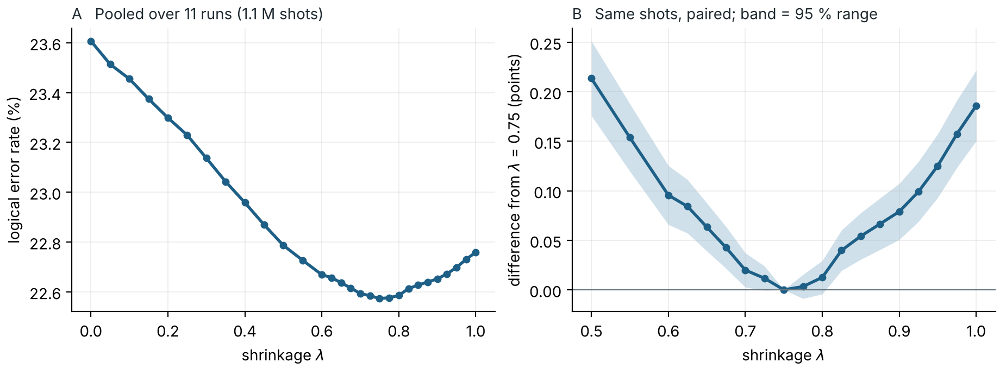

# Decoding Riverlane's Ankaa-2 stability experiments

An independent re-analysis of the public stability-8 data from

> A. Caune *et al.*, *Nature Communications* **17**, 7383 (2026); data: [Zenodo record 15364358](https://zenodo.org/records/15364358).

Starting from the raw readouts, the code rebuilds the detection events, checks them against Riverlane's published numbers, and then tests ways of improving the matching decoder: weights learned from the data, a blend of those weights with Riverlane's noise model, per-shot soft information from the IQ readout, and a reinforcement-learning (PPO) search over tied decoder weights. The procedure, fixed in advance, is then applied to the second experiment, with mid-circuit resets.

**How this was made.** The analysis was developed with an AI coding assistant (Claude, by Anthropic). I chose the problem and the dataset, directed the analysis, and checked the results against Riverlane's published numbers and independent tests.

## Results

Logical error rates are per shot; every shot is graded once by a decoder whose learned parts come from the *other* half of the shots (two-fold), and decoders are compared on the same shots with exact paired (McNemar) tests.

| | Result |
|---|---|
| Reconstruction | detection events reproduce all 100 per-round defect rates of the 26-round run exactly, and the FPGA decoder's logical error rate exactly in 8 of 11 runs |
| Pairwise-correlation (p_ij) weights | worse than Riverlane's noise model in all 11 runs (29.45 % vs 23.61 % pooled): detection events stay correlated for more than ten rounds, driving boundary-edge probabilities negative |
| Blend, λ = 0.75 | beats the noise model in 11 of 11 runs (22.57 % pooled); a fine scan of λ is in `lambda_scan.py` |
| Blend + soft information | below Riverlane's best published decoder in all 11 runs without resets and all 5 runs with resets |
| PPO, 44 tied weights, 25 rounds | 15.86 %, against 17.62 % for Riverlane's best published decoder and 20.55 % for their real-time FPGA decoder |
| PPO with resets, 23 rounds | 15.16 % → 14.46 % |
| Time-like distance (Stim) | N/2 without resets, N with resets |

**Caveats.** λ = 0.75 and the PPO knob design were chosen on the runs without resets. The soft information is fitted from the experiment's own readings (two Gaussians, EM), not from Riverlane's calibration runs, which are not published.

More figures comparing the two experiments are in `figures/`.

## Running it

1. Python 3.10 or later: `pip install -r requirements.txt`
2. Download from the [Zenodo record](https://zenodo.org/records/15364358) into this folder (or the folder above it):
   `stability_8_without_resets_raw_data.h5`, `stability_8_with_resets_raw_data.h5`, `lep_mwpm.txt`, `lep_fpga.txt`, `defect_rates_per_round.txt`, `lep_mwpm_soft_info_pairwise_correlation_graph_with_resets.txt`
3. Run the scripts in this order. Each writes its outputs into this folder.

| Order | File | What it does | Time |
|---|---|---|---|
| 1 | `preprocess.py` | no-reset HDF → `detectors.npz`, with the checks against Riverlane's published numbers | seconds |
| – | `explore_readings.py` | a quick look at the IQ readings and the first-round firing rate | seconds |
| 2 | `pij.py` | generic, p_ij, every pair, blend, and both soft decoders for every no-reset run | 15–45 min |
| – | `lambda_scan.py` | the blend's λ on a fine grid, with paired tests and a nested choice of λ | 15–25 min |
| 3 | `drift_test.py` | drift within and across runs, and whether it hurts decoding | 2 min |
| 4 | `ppo.py` | PPO, no resets | about 12 min per direction |
| 5 | `preprocess_resets.py` | with-resets HDF → `detectors_with_resets.npz` | seconds |
| 6 | `resets_test.py` | the frozen procedure on the with-resets data | 5–10 min |
| 7 | `ppo_resets.py` | PPO with resets | about 30 min |
| 8 | `compare_resets.py` (+ `compare_figs_draw.py`) | every comparison and figure between the two experiments; reads the PPO results in `cloud_results/` | about 1 min |
| 9 | `reset_distance.py` | the time-like distance of both circuits, and Riverlane's model simulated for both | about 1 min |

`ankaa_core.py` is the shared module (noise model, decoding graph, p_ij and blend, soft information, paired test, PPO); every script imports it.

The `*_output.txt` and `*.json` files are the outputs of the runs quoted above (Stim 1.16.0, PyMatching 2.4.0). The simulations use fixed seeds.

## How the code was checked

- Detection events match Riverlane's published per-round defect rates and FPGA error rates (`preprocess.py`).
- The p_ij estimator recovers known error rates on synthetic data with the same graph.
- The scripts were refactored from earlier versions around `ankaa_core.py`; every refactored script reproduces the original results exactly (identical `.npz` files, tables, printouts, PPO policies and figures).
